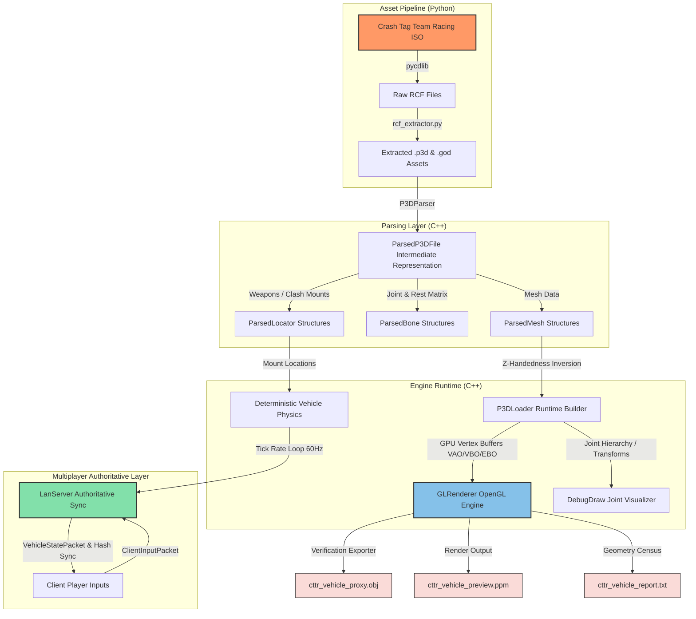

# Crash Tag Team Racing [US] PS2 Decompilation

[Contributing](CONTRIBUTING.md) · [Third-party notices](THIRD_PARTY_NOTICES.md) · [License](LICENSE)

[](https://en.cppreference.com/w/cpp/17)
[](https://www.opengl.org/)
[](https://cmake.org/)
[](https://www.python.org/)
[](https://microsoft.com/windows)

A high-performance C++ implementation of a deterministic vehicle physics simulation, networking synchronization layer, and real-time OpenGL rendering engine. This project is specifically designed to parse, reconstruct, and verify Radical Entertainment's proprietary **Pure3D (.p3d)** mesh, skeleton, and locator assets and **Radical Container Format (.RCF)** archives extracted from the PS2 version of *Crash Tag Team Racing (CTTR)*.

---

## 📌 Project Architecture

The codebase is split into distinct layers designed for deterministic execution, decoupling low-level asset parsing from runtime systems. Below is the system flow map:



---

##  Minimum Technical Requirements

1. **Deterministic Physics Engine (`src/physics/`)**: Fully float-stable vehicle dynamics replicating character karts. Utilizes modular clash/merge configurations for Driver & Gunner cooperative configurations.
2. **Deterministic Multiplayer State Sync (`src/network/`)**: An authoritative UDP LAN server tracking vehicle states, handling merger handshakes, aim replication, and state hashing to detect packet desynchronizations or client hacks.
3. **Pure3D Binary Decoders (`src/parser/`)**: A robust parser handling standard Pure3D meshes and Radical Entertainment's proprietary modern extensions (`CHUNK_SKELETON_2`, `CHUNK_SKELETON_JOINT_2`, `CHUNK_LOCATOR`). It handles unique length-prefixed strings, 4-byte padding alignments, and PS2 MemoryImage lists.
4. **Modern OpenGL Context (`src/renderer/`)**: Real-time rendering pipeline using GLFW, GLAD, and GLM. Employs a custom `DebugDraw` context mapping skeletal joint tripods, RGB coordinate frames, and white bone-links alongside real-time meshes.
5. **Headless Verification Exporter**: Automated model exporters generating standalone verification assets including `.obj` visual proxies, `.ppm` framebuffer screen dumps, and geometry reports.

---

##  Documentation

The guides describe the major project areas and workflows.

| Document | Scope | Key Coverage |
| :--- | :--- | :--- |
| [RCF & Asset Pipeline](docs/PIPELINE_AND_EXTRACTOR.md) | `tools/` | ISO extraction, Radical Container Format (RCF), and asset registry. |
| [Physics & Authoritative Networking](docs/PHYSICS_AND_NETWORKING.md) | `src/physics/`, `src/network/` | Physics simulation, vehicle merging, network packets, and determinism checks. |
| [Renderer & Verification Exports](docs/RENDERER_AND_VERIFICATION.md) | `src/renderer/` | OpenGL rendering, debug visualization, and verification exports. |
Pure3D parsing details are maintained alongside the implementation in [`src/parser/P3DParser.cpp`](src/parser/P3DParser.cpp) and [`src/parser/ParsedP3D.h`](src/parser/ParsedP3D.h); there is no separate `P3D_FORMAT.md` guide in this repository.

---

##  Building & Getting Started

###  Prerequisites

To compile the C++ engine, ensure the following utilities are present:
- **CMake** (v3.20 or higher)
- **C++17 Compiler** (MSVC 2019+ or GCC 9+)
- **OpenGL Development Headers** (Standard on Windows/Linux)
- **Python 3.8+** (for pipeline extractions)
- **pycdlib** Python library (`pip install pycdlib` for raw ISO extraction)

###  Compilation

Build the C++ binaries via CMake:

```powershell
# Create build directory
mkdir build
cd build

# Configure CMake
cmake .. -DCMAKE_BUILD_TYPE=Release

# Compile all targets (cttr_online and test_determinism)
cmake --build . --config Release
```

The compiled binaries will be output in your build structure:
- `cttr_online.exe`: Main server and GL visualizer.
- `test_determinism.exe`: Engine simulation determinism unit tests.

###  Running the Simulation & Server

The server requires asset configuration, defaulted to `game_data` in the project root:

```powershell
# Run the server and GL verification window
.\build\Release\cttr_online.exe
```

You can optionally supply a custom asset path:
```powershell
.\build\Release\cttr_online.exe "C:\Users\Adam\Desktop\eXTRACTED"
```

### Verifying Determinism

Verify the physics and simulation stability:

```powershell
.\build\Release\test_determinism.exe
```

If successful, the output will match:
```text
Deterministic vehicle scenario hash: 0xa5b8cf02e1c94b7f
```

---

## Project Changelog

Refer to the [CHANGELOG.md](CHANGELOG.md) to track features, fixes, and reverse-engineering updates chronologically.
