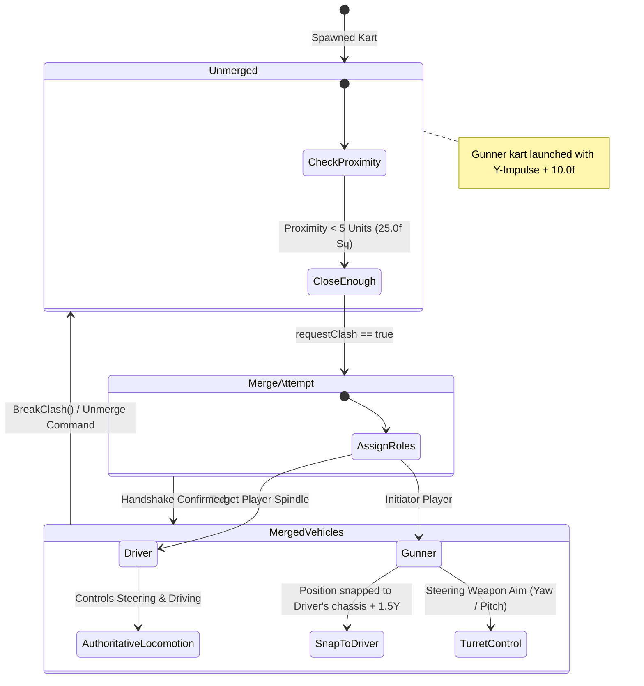

# Deterministic Physics & Authoritative Networking Guide

This document describes the design and specifications of the server-authoritative physics simulation, real-time input replication, and determinism verification framework inside **CTTR Online**.

---

## ⚡ Authoritative LAN Sync Engine

To prevent hacking and guarantee synchronization across multiple client nodes, the architecture employs a strict **Server-Authoritative Multiplayer Layout**:

```
[ LAN Client 1 ]             [ LAN Client 2 ]
       |                            |
       | Send ClientInputPacket     | Send ClientInputPacket
       v                            v
+------------------------------------------+
|          Authoritative LAN Server        |
|  - Validates Client Inputs               |
|  - Runs Deterministic 60Hz Physics Tick  |
|  - Compiles Master State Snapshot        |
+------------------------------------------+
       |                            |
       | Broadcast State Data       | Broadcast State Data
       v (VehicleStatePacket)       v (VehicleStatePacket)
[ LAN Client 1 ]             [ LAN Client 2 ]
```

### 🧭 Simulation Loop Setup
- **Server Tick**: Runs at a deterministic fixed interval of **60Hz** (`deltaTime = 1.0f / 60.0f`).
- **Inputs**: Clients capture local keyboard/controller states and dispatch a `ClientInputPacket`. The server buffers and applies inputs onto the authoritative vehicle representations.
- **State Broadcast**: The server updates physics, compiles a unified `VehicleStatePacket` array, and broadcasts it to all clients. Clients update their local visuals based on this authoritative data.

---

## 🏎️ Vehicle Physics Engine (`src/physics/`)

The physical simulation is modeled after original game data offsets (specifically `0x004A2F10` on the retail PS2 release).

- **Acceleration Model**: Max vehicle torque acceleration is capped at `50.0f` units.
- **Locomotive Drag**: Velocity decays linearly by a coefficient of `0.95f` per physics update frame to prevent infinite acceleration.
- **Braking**: Braking input nullifies linear velocity vectors directly.

---

## 🤝 Clashing / Merging State Machine

The defining gameplay mechanic of *Crash Tag Team Racing* is **clashing**—the ability for two distinct player karts to collide and merge into a single co-op weaponized vehicle.



### 1. Merge Proximity Heuristic
To initiate a clash, a client checks if their kart can merge with a target. The server validates this using a proximity radius check:
$$\text{ProximitySq} = (X_{\text{local}} - X_{\text{target}})^2 + (Z_{\text{local}} - Z_{\text{target}})^2 < 25.0\text{ units}^2$$
This matches a **5.0 unit proximity radius**.

### 2. Driver vs Gunner Cooperative Roles
Upon a successful clash handshake, the two karts transition to a cooperative state machine:

- **The Driver (Target Kart)**:
  - Assumes full control of combined kart locomotion.
  - Receives throttle/steering keyboard inputs.
  - Moves normally via C++ physics.
- **The Gunner (Initiating Kart)**:
  - Bypasses standard vehicle movement physics.
  - Position snaps to the back of the Driver's kart with a vertical vertical displacement of **`+1.5f` units**.
  - Direct velocity vectors are nullified to prevent physics solvers from fighting the coordinate snapping.
  - Assumes control over turret aiming (`AimTurret(yaw, pitch)`) and fires projectiles (`FireWeapon()`).

### 3. Unmerging Mechanics
When breaking a clash (`BreakClash()`):
- Both vehicles reset to independent `ClashRole::NONE` states.
- **CTTR Unmerge Impulse**: To throw players clear and replicate the original game feel, the Gunner's vehicle is thrown upward and backward with a significant impulse velocity boost:
  $$V_{\text{gunner, Y}} += 10.0\text{ units/sec}$$

---

## 🛰️ Network Protocol Packet Layouts

The sync layer in `src/network/LanGameSync.h` utilizes two lightweight binary packet types.

### 1. `ClientInputPacket` (Client-to-Server)
Dispatched by clients to replicate raw controller and command actions:
```c++
struct ClientInputPacket {
    uint32_t clientId;     // ID of client sending input
    float throttle;        // Range: [-1.0f (Reverse), 1.0f (Accelerate)]
    float steering;        // Range: [-1.0f (Left), 1.0f (Right)]
    bool brake;            // Actively braking
    bool requestClash;     // Initiating merge check
    float aimYaw;          // Gunner turret Yaw rotation
    float aimPitch;        // Gunner turret Pitch rotation
    bool fireWeapon;       // Shooting turret projectile
};
```

### 2. `VehicleStatePacket` (Server-to-Clients)
Broadcast by the server at 60Hz to replicate the master physics simulation:
```c++
struct VehicleStatePacket {
    uint32_t vehicleId;    // Target vehicle
    float x, y, z;          // Absolute Position coordinates
    float vx, vy, vz;       // Direct Velocity vector
    float rx, ry, rz;       // Rotation vector
    bool isMerged;          // Active clash state
    ClashRole role;        // Role: [NONE, DRIVER, GUNNER]
    uint32_t partnerId;     // Joined vehicle ID
    float turretYaw;        // Current turret yaw orientation
    float turretPitch;      // Current turret pitch orientation
    bool isFiring;         // Fire render flag
};
```

---

## 🧪 Determinism Verification Unit Testing (`test_determinism.cpp`)

Multiplayer synchronization fails if physics engines contain non-deterministic floats, CPU thread variations, or platform-specific mathematical drift. To guarantee strict determinism, `test/test_determinism.cpp` executes a complex multiplayer scenario:

1. **Setup**: Spawns two vehicles (IDs `1` and `2`).
2. **Driving**: Vehicle 1 applies full throttle for **90 frames** (1.5 seconds at 60Hz).
3. **Clashing**: The vehicles merge: Vehicle 2 merges as `GUNNER` on Vehicle 1 (`DRIVER`).
4. **Turret Steering**: Vehicle 2 aims the turret for **30 frames**.
5. **Separation**: The vehicles break the clash. They update independently for another **30 frames**.

### 🧮 FNV-1a Deterministic State Hashing
At the end of the simulation runs, the scenario compiles a **64-bit non-cryptographic FNV-1a Hash** mapping the complete physics state (positions, rotations, velocities, clash states, partners, and aiming structures).

The hash utility uses the following constants:
- **FNV Offset Basis**: `14695981039346656037` (`0xcbf29ce484222325`)
- **FNV Prime**: `1099511628211` (`0x100000001b3`)

```c++
void HashU32(uint64_t& hash, uint32_t value) {
    hash ^= value;
    hash *= FNV_PRIME;
}
```

The master verification hash combines the final states of the entities:
$$\text{Master Hash} = \text{Hash}_{\text{Driver}} \oplus (\text{Hash}_{\text{Gunner}} \ll 1)$$

If a single float drift occurs or any coordinate diverges by a single bit, the hashes will mismatch, failing compilation checks. Running `test_determinism.exe` guarantees absolute math correctness:
```text
Deterministic vehicle scenario hash: 0xa5b8cf02e1c94b7f
```
